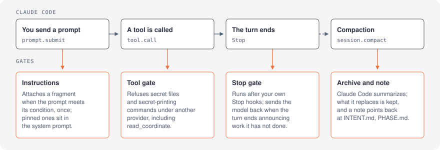

# context-harness

**Long Claude Code sessions, kept exact and kept in step with you: tool results fold instead of vanishing into a summary, and a judgment layer checks the moments an agent most often gets wrong.**

English · [한국어](README.ko.md)

context-harness is a Claude Code plugin, written against Claude Code's mod API (function hooks). It has two halves, built to work as one:

- **Folding.** When a conversation compacts, the engine replaces it with a summary, and the exact output of every file read and command run leaves with it. context-harness folds instead: each large, older tool result becomes a one-line pointer, the original is kept on disk, and the model reads it back with `read_coordinate`. Your own prompts, the tool calls and the most recent results stay as they were. Folding needs no setup and no key.
- **Judgment.** Gates that ask Jev, TypeSafe's decision model, at the points of a turn where an agent goes wrong: a turn that ends by announcing work it has not done, a call that touches a secret file, an instruction that applies only to some requests, an instruction file loaded twice, a result the current request still needs. Each gate is off until you turn it on; while every gate is off, nothing leaves your machine.

The two halves rest on one rule: **the original stays in the archive, and the context holds only what the work in front of you needs.** Folding decides that per tool result, the kept blocks under a pointer decide it per passage, `read_coordinate` with a `query` decides it again when the model reads an original back, and `web_read` decides it for a web page. Where a judgment is worth the wait, Jev makes it; where it is not, a rule does, and the rule is always the floor.

[Install](#install) · [Commands](#commands) · [How folding works](#how-folding-works) · [Project state](#project-state-and-memory) · [Instruction files](#instruction-files) · [Judgment layer](#judgment-layer) · [Data and privacy](#data-and-privacy) · [Measured](#measured) · [Limits](#limits)


A real pointer, as the model sees it; the id is what `read_coordinate` takes:

```text
[folded Read · src/billing/invoice.ts · 1201 lines — read_coordinate("toolu_01J7igoRSuY8xw8F8skCSEY3")]
```

## Install

Requires Claude Code 2.1.306 or later. The mod API it uses is marked early access and may change between releases. At the prompt of a Claude Code terminal session:

```text
/plugin install context-harness --marketplace ysys143/context-harness
```

Answer `y` to add the marketplace, then pick a scope. The install may list the settings as not set: the defaults [below](#how-folding-works) apply until you change them in `/config`.

<details>
<summary>From a shell, or the desktop app</summary>

- Shell: `claude plugin install context-harness --marketplace ysys143/context-harness`
- Desktop app, where `/plugin` does not run: + next to the prompt box, Plugins, Add marketplace `ysys143/context-harness`, then Add plugin.

</details>

Then run **`/install`** in a session. It says whether a Jev key was found and from where (never the key itself), what each gate sends when it is on, and where the settings and the key can live so every Claude Code profile shares them. It sends nothing.

Coming from context-fold or jev-harness: uninstall them first, then see [Upgrading](#upgrading).

**Check that it works.** Have the model read a file of a few hundred lines, send two more prompts so that result is no longer recent, then run `/compact`. The status line shows `folded 1 · −Nk chars`. Ask for a line of that file without opening it again, and the model fetches it with `read_coordinate`.

## Commands

| Command or tool | What it does |
| --- | --- |
| `/install` | What the plugin needs, what each gate sends, where the shared settings and key go; sends nothing |
| `/compact` | Compacts now; the plugin answers by folding |
| `read_coordinate` | The model's tool (`mcp__context-harness__read_coordinate`): a folded original, a range of its lines (`offset`, `limit`), only the passages that bear on a `query`, or the whole of it (`full`) |
| `/context-harness:tune-policy` | Measures your session and picks the fold settings with you |
| `/context-harness:project-state` | Keeps `INTENT.md` and `PHASE.md` |
| `/context-harness:consolidate` | Turns a stretch of work into memory that lasts |
| `/jev-report` | What the [judgment layer](#judgment-layer) recorded, and what each compaction held and saved |
| `/jev-mark <id> y\|n` | Labels one of its records yes or no |
| `/config` | All settings, under context-harness |

## How folding works

A tool result is folded when it is finished and large: older than the last `keepRecentTurns` turns, at least `minFoldChars` long, not an error shorter than `keepErrorsUnder`, and not from a tool in `keepTools`. A result whose pointer would be longer than itself stays, and so does every result in a message that holds an image or a document (see [Limits](#limits)).

1. **At compaction** (`/compact`, the engine's automatic compaction, or step 4), the plugin answers in place of the engine's summary. Each result that qualifies is written to the archive and replaced by its pointer; every other message is handed back untouched.
2. **If folding is not enough**, because the folded transcript still fills more than 60% of the window, the engine summarizes only what is older than the recent window. The recent turns are carried over as they stand, folded where the rule says so. The plugin then puts back two things a summary would lose: every prompt you wrote in the summarized part, in order, and one message listing the pointer of every folded original, so the model keeps a way to each. When nothing qualifies to fold or the archive cannot be written ([Data and privacy](#data-and-privacy)), the engine summarizes the whole transcript. The 60% is a fixed share, not `foldAtPercent`, measured on an estimate from the transcript's characters rather than a token count.
3. **A summary waits for the status board.** If the project keeps `PHASE.md` or an episode log ([Project state](#project-state-and-memory)) not written since the last compaction, the summary is held back and the agent is asked to bring them up to date; the fold itself goes ahead. A summary replaces what you said with the agent's reading of it, and the board is where that reading lives. After two requests it summarizes without asking.
4. **At an idle boundary**, when a turn has ended with the window at least `foldAtPercent` full, the plugin starts a compaction itself, but only if folding would remove at least `minSavedPercent` of the transcript: each compaction rebuilds the prompt cache once. It waits 30 seconds first and stands down if you write in that time, so your next request is never queued behind a summary. While a summary runs, the status line says so.
5. **After a compaction** that folded something, or in a project that keeps those files, it appends a note: how many results were folded, which of the project's files to re-read, and, when there is a status board, that its Handoff section is what a session picking this up reads first.
6. **`read_coordinate`** returns an original by the id in its pointer, 400 lines at a time unless `offset` and `limit` say otherwise. With a `query` and a Jev key, it returns only the passages that bear on it, quoted, and names by line number the ranges it left out; `full: true` returns the whole original. Without a key, a `query` returns the whole original rather than a fragment nothing chose.

| Setting | Default | Why |
| --- | --- | --- |
| `keepRecentTurns` | 2 | The work in progress still reads the most recent turns |
| `minFoldChars` | 1000 | In a measured session, 44% of results held 90% of all tool output |
| `keepErrorsUnder` | 2000 | Short errors stop the model repeating the same mistake |
| `keepTools` | `TodoWrite,AskUserQuestion,ExitPlanMode` | Small, and they hold current decisions |
| `foldAtPercent` | 60 | When to fold by itself after a turn; 0 turns it off |
| `minSavedPercent` | 20 | Fold by itself only when it saves at least this share |
| `intentFile` | `INTENT.md` | The agent's reading of what you want; empty turns it off |
| `phaseFile` | `PHASE.md` | The status board, and the handoff; empty turns it off |
| `episodeDir` | `sessions` | The episode log folder; empty turns it off |
| `imageMaxPx` | 0 | Read images larger than this on their long side as a smaller copy; 0 is off |

`/context-harness:tune-policy` measures your session with the folding code itself (`policy_report`), asks you a few questions, dry-runs the values you chose beside the current ones, and applies them only after you agree (`set_policy`, which writes the nine fold settings above it and no other).

**Images.** An image costs about width × height / 750 tokens, up to roughly 1,550, and a fold never takes one, so a screenshot read early is paid for on every request until the session ends. With `imageMaxPx` set, a `Read` of a PNG or JPEG larger than that on its long side reads a copy downscaled with `sips` (macOS) or ImageMagick (`identify`, `convert`; Linux) instead; the copy is kept beside the archive and reused. If the size cannot be read or the resize fails, the original is read. A PDF and an image you paste keep their size.

## Compared with

- **Claude Code's own compaction** replaces the conversation with a summary. context-harness answers the same compaction first and folds; a summary runs only when folding is not enough, then only over what is older than the recent window, with your prompts and the folded pointers put back.
- **Memory plugins** keep what was learned across sessions, in a store of their own. context-harness works inside a session: exact tool output stays one call away, and what should last is written by the agent into the project's own files (`INTENT.md`, `PHASE.md`, `sessions/`).

## Project state and memory

A compaction summary is never the source of truth; files the project keeps are. The plugin uses three, each only while it exists, and never writes them itself: the agent does, and the plugin checks and points.

| File | What it holds | Written when |
| --- | --- | --- |
| `INTENT.md` | The agent's reading of what you want: goal, done-when, scope, constraints, open questions, each line citing your own words | You state or change a goal |
| `PHASE.md` | The status board you read: now, next, what needs you, done with evidence, resume notes; with several agents, who owns what. Its **Handoff** section is for the session that picks the work up: the branch and worktree, whether the commits are pushed, what is uncommitted, the command to run first, and what not to repeat | A step ends or blocks, you decide, the commit state changes, before a handoff, when the plugin asks |
| `sessions/<date>-<slug>.md` | Episodes: what happened, when, and the evidence (paths, commits, folded `read_coordinate` ids) | Each stretch of work, append-only |

- **A project with no status board is offered one.** On the first prompt you write, the plugin asks, in Claude Code's own dialog, whether to create `PHASE.md`; the agent then writes it. Three hours with no answer counts as yes. The question is asked once: a no is remembered, and so is a yes, across sessions. A run with nobody to ask (`claude -p`) is never taken as consent.
- **The board is checked against the repository.** Before a fold, when the board is due, the request to bring it up to date also names what `git status` shows and the board's Handoff section should say: commits not pushed, files with uncommitted changes, or a board with no Handoff section at all.
- `/context-harness:project-state` keeps `INTENT.md` and `PHASE.md`, alone or across several agent sessions, with the rules that keep one board consistent and the steps a resuming session follows.
- `/context-harness:consolidate` turns a stretch of work into memory that lasts: the board, an episode, repeated procedures as project skills, lasting principles into `AGENTS.md` once you agree. A deterministic procedure that keeps repeating is proposed as code: see [just-dag-it](https://github.com/ysys143/just-dag-it).

## Instruction files

Claude Code loads its instruction files whole at the start of a conversation and again after each compaction: the user `CLAUDE.md` of the profile in use, a project's `CLAUDE.md` and `AGENTS.md`, every file they `@`-import, and the `.claude/CLAUDE.md` of every folder above the working folder. That last rule means a session run from inside your home folder also loads `~/.claude/CLAUDE.md` as a project file. If another profile's `CLAUDE.md` (say `~/.claude-3/CLAUDE.md`) is a copy of it, the same text loads twice.

**The fix needs no plugin.** In each profile other than `~/.claude` that keeps its own copy, exclude the shared one:

```json
{ "claudeMdExcludes": ["/Users/you/.claude/CLAUDE.md"] }
```

Never put this in `~/.claude/settings.json` itself: there the same file is the profile's own user file, and the profile would lose it. In the author's setup it took the first request from 69,152 to 66,655 tokens (the OMC block, 5.9k characters, loaded once instead of twice).

**`instructionFilter`** (`off`, `shadow`, `active`; default `off`) handles what is left, through the engine's `prompt.context` hook, which hands a plugin the instruction files just before they are sent. It splits them into chunks by heading and by tag block, keeping code fences whole, and then:

- **Loaded twice, byte for byte** (whitespace aside): `active` leaves the later copy out and puts a one-line note where it was (`[context-harness: left out "…", loaded from …]`), so the model knows. Of two OMC blocks at different versions, the older one leaves. Organization (`managed`) files and the auto-memory index are never changed.
- **Jev's reading of the rest, recorded only, in either mode:** after the request has gone, Jev is asked of every chunk whether nearly every request needs it, and of every user-level chunk whether the chunks before it already say all of it. `/jev-report` lists what that would drop or defer, and why. These rules are never dropped or deferred: identity, language, autonomy and approval, answering questions first, shell, git, API keys, browser, any section whose heading contains 중복 or 강조 (how the author marks a deliberate repetition; a heading worded otherwise is judged by Jev), and the OMC block. The Orca section is decided by the environment, not by Jev.
- **Would-miss:** for every prompt, slash commands included, Jev is asked whether the chunks it would defer apply. Tool uses of their kind (browser, web fetch, `orca`, `claude -p`) are recorded too, and `/jev-report` counts how often that work began with the chunk not yet attached.

Jev's readings are applied only once the records support it: at least 20 chunks labeled covered and 60 labeled partly or new with precision of 0.95 or more at the threshold, and a would-miss rate under 5% over 30 or more real sessions. Until then they cost a few hundred milliseconds in the background and nothing on the request path: `prompt.context` itself takes about 30 ms.

## Judgment layer



Each gate is set on its own to one of three modes:

- **`off`**, the default for every gate, with or without a key: the gate does nothing and sends nothing.
- **`shadow`**: the gate judges (Jev, or a rule for the tool gate floor) and records the judgment; nothing changes. Start here.
- **`active`**: the judgment acts: the model is sent back to work, a call is refused, a fragment is attached. A Jev judgment that acts holds the turn, the call or the prompt while Jev answers: usually 0.2-0.35 s, at most 2 s (`timeoutMs`).

| Gate | Setting | What it does | What leaves the machine |
| --- | --- | --- | --- |
| Stop gate | `stopGate` | After your own Stop hooks, sends the model back to work when a turn ends by announcing work it has not done ("이어서 리팩터링하겠습니다", "Next, I will…") | The turn's last paragraph, scrubbed |
| Tool gate floor | `toolGate` | When another provider serves the session (for example Bedrock, Vertex, a proxy, or a non-Anthropic base URL; see *Tool gate in detail*), refuses calls that touch secret files or print secrets, `read_coordinate` included. In every session, refuses writes to this plugin's files, its archives and Claude's settings files | Nothing |
| Tool gate Jev | `toolJev` | When another provider serves the session, classes each call the floor let through as open, standard, restricted or custom from its path or command, and refuses restricted and custom | The tool name and the scrubbed target |
| Conditional instructions | `instructions` | Attaches an instruction fragment to the prompt that first meets its condition | Your prompt, scrubbed, first 600 characters, and the fragments' conditions (never their bodies) |
| Instruction filter | `instructionFilter` | Leaves instruction chunks loaded twice out (`active`), and records Jev's reading of the rest ([Instruction files](#instruction-files)) | With a key: the instruction files' text, scrubbed, when they change; for chunks Jev would defer, each prompt's first 600 characters, scrubbed |
| Fold relevance | `foldJev` | `shadow` records which of the largest earlier results your request still needs, beside what the fold did. `active` lets that decide the fold, only on a compaction you asked for (`/compact`): a result Jev says is still needed (at least `foldThreshold`, 0.3) stays whole, and one it says is done with is folded even inside the recent window. The rule stays the floor: a short error, a tool in `keepTools` or a result under `minFoldChars` is never folded. An automatic compaction is decided by the rule alone, so nobody waits for Jev | Your last prompt, scrubbed, first 400 characters, and for each result its tool and target: the path, the start of the command, or the search pattern, URL or description it was called with (never its output) |
| Web reading | `webRead` | `active` adds a `web_read` tool that returns only the blocks of a page that answer the question, verbatim, and keeps the whole page for `read_coordinate`; `shadow` measures the same beside each WebFetch call and changes nothing ([Blocks](#blocks-web-reading-and-kept-fold-blocks)) | The page's text and the question, scrubbed |
| Browser routing | `browserRoute` | For each prompt you write, decides whether it needs a web browser operated (keywords, else Jev); `active` attaches one instruction naming the installed tool to use, in the order ego-browser, Aside, agent-browser, Playwright, then a CDP tool you name in `browserCdp`. With none installed, the model is told so and you are told once in 14 days | Your prompt, scrubbed, first 600 characters, when no keyword decides |
| Kept fold blocks | `foldBlocks` | At a compaction, keeps the blocks of the largest folded results that your last prompt still needs, verbatim under the pointer (`active`), or records which it would keep (`shadow`) | Those results' text and your last prompt (first 400 characters), scrubbed |

Scrubbing removes secret-shaped strings, `NAME=value` secrets, email addresses and your home folder, then replaces Korean personal information with a label such as `[전화번호]`. That second pass is a TypeScript port of [maskingtape](https://github.com/ChoHyeonChan/maskingtape) 0.4.0 (Apache-2.0, in `hooks/pii/`), checked against the original on 2,594 inputs; it finds names by rules alone, for which the original reports a recall of 0.966. A text bounded in length is scrubbed first and cut after, never inside a label.

### Blocks: web reading and kept fold blocks

Both settings split a text into blocks (paragraphs, list items, table rows, code blocks, runs of up to 40 output lines), each under its heading path, and ask Jev in two stages which blocks answer a question: one request per window of blocks, then each candidate again with the text around it. What they keep goes out quoted, never paraphrased; the whole text stays in the archive, so a block judged wrongly is one `read_coordinate` away. The splitting and the judgment are ported from [jevfetch](https://github.com/a2sys-ai/jevfetch) (MIT, commit 167fe8f), with its questions and thresholds unchanged. They are the two gates that send text itself, not a description of it.

`web_read` output, as the model sees it:

```text
# web_read: https://www.rfc-editor.org/rfc/rfc9110.html
# status: filtered (blocks are quoted from the page; '##' lines are the page's heading path)
# 5/2122 blocks, about 387 of 117469 tokens
# whole page: read_coordinate("web-mh3k2a07")
## HTTP Semantics > 15. Status Codes > 15.5. Client Error 4xx > 15.5.20. 421 Misdirected Request
The 421 (Misdirected Request) status code indicates that the request was directed at a server that is unable or unwilling to produce an authoritative response for the target URI. ...
```

A kept fold looks like a pointer with the needed lines under it:

```text
[folded Read · hooks/register.ts · 598 lines — read_coordinate("toolu_…")]
[kept from the original, verbatim; the rest is in read_coordinate]
   441	    const below = await next(e)
   ...
```

Blocks are kept only when the judgment found an answer and they come to at most half of the result. `foldBlocksBudgetMs` (10 s) bounds how long a compaction waits; results still being judged then fold to a pointer alone.

### Turning it on

1. Get a key from the [TypeSafe console](https://console.typesafe.ai/home).
2. Give it to the plugin. It is read from the first of these that has one:
   1. `~/.context-harness/key`, the key alone in the file, read by every Claude Code profile;
   2. the plugin's secure setting, set from a shell with `claude plugin configure context-harness@context-harness` (kept separately for each profile);
   3. a `TYPESAFE_API_KEY=` line in a `.env` in the plugin's folder;
   4. the `TYPESAFE_API_KEY` environment variable.
3. Set the gates you want to `shadow`, in `/config` under context-harness, in `settings.json`, or in `~/.context-harness/config.json` (the same keys as `options` below, read by every profile, and taking precedence over a profile's own values):

   ```json
   {
     "pluginConfigs": {
       "context-harness@context-harness": {
         "options": {
           "stopGate": "shadow",
           "toolGate": "shadow",
           "toolJev": "shadow",
           "instructions": "shadow",
           "foldJev": "shadow"
         }
       }
     }
   }
   ```

4. Read `/jev-report`, label records with `/jev-mark`, and switch a gate to `active` once it earns it (see [Records and labels](#records-and-labels)).

Without a key, the status line says only `jev: no key` and nothing is sent. The tool gate floor needs no key. Otherwise the judgment layer's status line stays empty until a gate has recorded something: Claude Code draws every plugin status line with a warning mark, which a plugin cannot change, so a line that only said the gates were on would look like a fault. With `toolGate: active`, the agent cannot write the plugin's `.env` or Claude's settings files; set those yourself. The plugin only reads `~/.context-harness/`; the folder is yours to create and write.

<details>
<summary>Stop gate in detail</summary>

1. Your settings Stop hooks run first; if one blocks, that stands.
2. Not judged: re-entry, plan mode, background or scheduled work, subagents, a last sentence that is a question, and one with a condition ("알려주시면 처리하겠습니다", "once the checks pass…").
3. A rule looks for an announcing ending; Jev is asked a two-way choice, `announce` or `report`.
4. In `shadow` the turn ends at once and the judgment is recorded afterwards. In `active`, `announce` at or above `stopThreshold` (0.7) sends the model back to work: do it now, or say plainly what it needs from you.

</details>

<details>
<summary>Tool gate in detail</summary>

- **Provider trust.** First-party only when every sign agrees: an Anthropic credential, no `HTTPS_PROXY`/`HTTP_PROXY`, no `NODE_EXTRA_CA_CERTS`, no Bedrock/Vertex/Foundry, and an `ANTHROPIC_BASE_URL` that is empty or `https://*.anthropic.com`. A local proxy counts as external unless listed in `trustedProxies`. `providerTrust: external` forces external; nothing forces first-party.
- **Secret files.** `.env` and `.env.*` (not `.example`, `.sample`, `.template`, `.tpl`, `.dist`), `*.env`, `~/.ssh` (not `*.pub` or `known_hosts`), `~/.aws`, `~/.gnupg`, gcloud, `~/.kube/config`, `~/.docker/config.json`, `~/.config/gh/hosts.yml`, Codex and Claude credential files, `.netrc`, `.npmrc`, `.pypirc`, `.pgpass`, `.git-credentials`, `*.pem`, `*.p12`, `*.pfx`, `*.kdbx`, `*.keystore`, `*.jks`, `id_rsa` and kin, the opencodex proxy's token files under `~/.opencodex`, and `/proc/<pid>/environ`, resolved through `~`, `$HOME`, `..` and symlinks.
- **Shell.** Every argument of a Bash command is checked, including git pathspecs, `--opt=path` and redirects; `env`, `printenv`, `export -p`, `security … -w` and `gh auth token` count too.
- **Folded originals.** With the gate on in an external session, `read_coordinate` judges the call that produced a folded result as that call would have been judged, following a path that still exists to what it leads to; reading the archive folders directly is refused the same way. A secret file folded earlier does not come back either way.
- A guard that breaks in `active` refuses the call. `toolJev` asks once per target and session, never about a path the floor names.

</details>

<details>
<summary>Conditional instructions in detail</summary>

Claude Code already loads instructions by path (`.claude/rules/*.md` with `paths:`, CLAUDE.md in subfolders). These fragments are for conditions a path cannot tell, such as what you are asking for. A fragment is a Markdown file in `fragmentsDir` (default `~/.agents/fragments`, at most 24, each at most 4 KB):

```markdown
---
when: The person asks for prose meant for human readers, such as a report, an email or documentation.
keywords: report, email, 보고서
---
Lead with the conclusion. One idea per paragraph. Cut filler.
```

- **Attached once, kept.** A fragment is appended to the prompt that first meets its condition and stays in the conversation, so the cached prefix stays. Before each prompt, the plugin counts the fragments the next request still carries, and those attached to prompts still queued behind a running turn: a compaction that only folded keeps them, one the engine summarized drops them, and only dropped ones may be attached again.
- **A keyword decides without Jev**; otherwise one request asks about every fragment not attached, and `instructionThreshold` (0.95) attaches. `pin: true` puts a fragment in one fixed section at the end of the system prompt.
- Only prompts you write are judged. Write conditions narrowly: a broad prose condition reached 0.92-0.96 on "tell me in one sentence what this file shows".
- `examples/fragments/` has three generic fragments to copy.

</details>

<details>
<summary>Fold relevance in detail</summary>

At a compaction the prompt cache is rebuilt anyway, so judging what to keep costs no cache there. Jev is asked, for up to 48 of the largest results the fold could act on (at least `minFoldChars`), whether your current request still needs it, shown only as its tool, target and size. Each record holds what the fold did with that result and Jev's probability that it is done with. In `shadow` that is all. In `active`, on a compaction you asked for, the question is asked before the fold, of every result the rule would fold if recency did not count, and the answers decide it. A result Jev gave no answer for is decided by the rule. Kept fold blocks then work only inside what was folded: a result kept whole is not asked about again, block by block.

</details>

### Records and labels

- `/jev-report`: per gate, records, skips by reason, coverage, failures by kind, latency, tokens, the rule-versus-Jev table with Cohen's kappa, unlabeled disagreements, and, once labeled, precision and recall at several thresholds.
- `/jev-mark <id> y|n`: label a record yourself.
- Every compaction is recorded as well, with or without a key: its trigger, how long it held the turn, whether a summary ran, and, when one did, the window before and after as the engine counted it (a fold alone reports no token counts). `/jev-report` shows them under `compact`. These are your own sessions' numbers, read off the engine, which is what any change to the fold settings should be judged by.

Before switching the Stop gate to `active`, aim for at least 50 positive and 100 negative labels and a threshold with precision of 0.9 or more on them. Agreement with the rule alone is not evidence: the rule flags about 5% of turn ends, so a gate that always says "no" agrees about 95% of the time.

`scripts/replay.ts` (run with `bun`) replays past transcripts (`$CLAUDE_CONFIG_DIR/projects`, or `~/.claude/projects`) through the Stop rule offline; `--jev N` sends up to N scrubbed paragraphs to Jev.

### What Jev costs

With every gate on, one session costs at most about $0.03, and the author's last 30 days on a Claude Max 20x plan would have cost $0.28-1.00. The larger cost is time: in `active`, a judged turn end, the first call to each target in an external session, and a prompt with an unattached fragment and no keyword hit each wait for Jev, usually 0.2-0.35 s and at most 2 s (`timeoutMs`).

<details>
<summary>Per call, per session and per plan</summary>

Jev bills input tokens only, $0.042 per million ([TypeSafe's Models page](https://docs.typesafe.ai/models), 2026-10-23); output is free. A call from this plugin sends 370-500 input tokens, about 70 more for each further question in the same request.

| Gate | When it calls | Input tokens per call | Cost |
| --- | --- | --- | --- |
| Stop gate | Each turn end it judges (about 60%; the rest are skipped) | ~400 | $0.017 per 1,000 turn ends |
| Conditional instructions | Each prompt you write while some fragment is not attached | ~400 with 3 fragments, ~2,000 with 24 | $0.017-0.084 per 1,000 prompts |
| Fold relevance | Each compaction, one call per 24 results, at most two | up to ~2,500 | $0.21 per 1,000 compactions |
| Tool gate Jev | Each new target in a session another provider serves | ~455 | $0.019 per 1,000 targets |
| Instruction filter | Each new set of instruction files (two calls), then each prompt while some chunk would be deferred | ~13,600 per set, ~1,730 per prompt | $0.0006 per set, $0.073 per 1,000 prompts |

The session caps (`stopCap` 200, `instructionCap` 200, `foldCap` 20, `toolCap` 300 calls) bound one session at about 670,000 input tokens: $0.03. The instruction filter draws on `instructionCap` too.

Web reading and kept fold blocks send text, so they cost more per use and are left out of the figures above. Measured on 2026-10-27 (seven documentation pages; three files of this repository read as `Read` returns them):

| Use | Jev requests | Input tokens | Cost |
| --- | --- | --- | --- |
| A short page (under ~2,000 tokens) | 0 | 0 | none: returned whole |
| A documentation page of 2,000-8,000 tokens | 6-9 | 17,000-37,000 | $0.0007-0.0015 |
| A long reference (Node.js `fs`, RFC 9110; 87,000-117,000 tokens) | 38-58 | 345,000-536,000 | $0.014-0.023 |
| One folded result of 16,000-40,000 characters | 5-9 | 12,000-25,000 | $0.0005-0.001 |

`webReadCap` (600 requests) and `foldBlocksCap` (300) bound a session at roughly $0.25 and $0.04 more. The time is in the tool call or the compaction: 0.2-1.6 s per page in that measurement, the requests running 16 at a time.

The author's own use, priced as if every gate were on (2026-10-23, counted from Claude Code transcripts; nothing was sent), one Claude Max 20x account on two machines:

| Period | Sessions | Prompts | Tool calls | Compactions | Typical | Upper |
| --- | --- | --- | --- | --- | --- | --- |
| One week, 68% of the weekly limit used | 121 | 1,495 | 30,485 | 66 | $0.05 | $0.25 |
| That week scaled to 100% of the limit | | | | | $0.07 | $0.37 |
| 30 days | 764 | 5,812 | 182,775 | 165 | $0.28 | $1.00 |

*Typical* is three fragments, and the tool gate's Jev only where another provider served the session (none that week; 38 of 764 sessions over 30 days). *Upper* is 24 fragments asked on every prompt and every session served by another provider. Used up to its weekly limit, a Max 20x plan comes to about $0.32 a month typical and $1.57 at the upper end, 0.2-0.8% of the plan's $200 ([Claude pricing](https://claude.com/pricing)); Max 5x allows a quarter of Max 20x's usage, so roughly a quarter of that. The weekly limit also counts use outside Claude Code, which runs no plugin, so Claude Code alone at 100% would cost somewhat more.

</details>

## Data and privacy

Everything the plugin keeps is under one folder only you can open; every folder is made 700 before anything is written in it, and made again the same way if it was removed during a session. When that fails, nothing is written and the engine summarizes:

```text
~/.local/state/context-harness/
  archive/<session>/<tool_use_id>.json   folded originals, never deleted
  records/<session>/<gate>/<id>.json     judgment records, kept 14 days
  records/labels/labels/<id>.json        your labels, kept
  replay/                                replay output
  shrunk-<path>                          downscaled image copies (imageMaxPx), reused
~/.context-harness/                      yours to write; the plugin only reads it
  config.json                            settings shared by every profile
  key                                    the Jev key, shared by every profile
```

An archive file holds exactly what the tool returned; `web_read` adds the page it read, as blocks, under `web-<id>`. A record holds what was sent (scrubbed), the verdicts and the timings; for web reading and kept fold blocks, which send text, it keeps the question and the size of the text, not the text.

Folds from before the rename stay at `~/.claude-context-fold/<session>/`; the plugin reads them and never writes or deletes there. Without `HOME`, it folds nothing and lets the engine summarize, rather than write into the project. To remove what it kept:

```sh
rm -rf ~/.local/state/context-harness/archive/<session-id>   # one session's originals
rm -rf ~/.local/state/context-harness ~/.claude-context-fold # everything
```

The plugin uses, and only for this: the network (Jev, only with a Jev setting on and a key), processes (`mkdir`, `chmod` and `find` on its own folder; `git status` in the working folder, read only, when a fold is due and there is a status board to check; `sips`, or `identify` and `convert`, on an image `Read` is about to open, with `imageMaxPx` set), and the environment (`HOME`, `TYPESAFE_API_KEY`, and the proxy and provider variables the trust check reads). One module uses all of them, folding included, so a policy that judges a module by what it uses judges the folding with them.

## Measured

| What | Result | Measured with |
| --- | --- | --- |
| One compaction | 137,469 → 36,995 tokens, 30 ms | context-fold 0.0.2 |
| A folded file, asked for row 777 | Read back with `read_coordinate` (`offset: 777, limit: 1`), answered correctly | context-fold 0.0.2 |
| Fold and its judgment in one compaction | 2 results folded (−32k characters); each record matches the archive | context-harness 0.0.1 |
| A fragment after a fold-only compaction | Kept once, not attached again (jev-harness attached it twice) | context-harness 0.0.1 |
| Stop gate, `active`, 12 ordinary turns | No false block | jev-harness 0.0.3 |
| Tool gate, external session | `.env`, a symlink to a `.pem` and `printenv` refused; 2-4 ms per call | jev-harness 0.0.3 |
| A Jev call, two-way choice | 206 ms p50, 339 ms p95 | jev-1.14.0 |
| The shared `CLAUDE.md` excluded in a second profile | OMC block loaded once, not twice; first request 69,152 → 66,655 tokens | Claude Code 2.1.309 |
| A chunk loaded twice, `instructionFilter: active` | Loaded once, with the note in place of the copy; `prompt.context` took 31 ms | context-harness 0.0.2 |
| Jev's reading of 34 real instruction chunks | Would defer 5 (1,770 characters), drop 0; nothing on the always-kept list | context-harness 0.0.2 |
| Stop rule against Jev, 100 paragraphs | Agreement κ 0.35 | jev-harness 0.0.3 |
| A broad fragment condition | 0.92-0.96 on unrelated one-sentence questions | jev-harness 0.0.3 |
| Stop gate on real announcements | Not measured yet: ordinary turns never ended on one | jev-harness 0.0.3 |

Live runs used Claude Code 2.1.306-2.1.308 with Haiku 5.5 in the author's own folders; the Jev timings are direct API calls, and the rule replays use the author's transcripts.

<details>
<summary>context-harness 0.0.2 (2026-10-23, Claude Code 2.1.309, Haiku 5.5, the author's own instruction files)</summary>

- **`prompt.context`** fired once before the first prompt, and again on the first prompt after `/compact` and after `/clear`. A general-purpose subagent got the rewritten files without the hook firing again: its recorded instructions lacked the section the hook removed.
- **Loaded twice.** With a section of `~/.agents/AGENTS.md` copied into a project `CLAUDE.md`, `shadow` loaded both (counted twice in the first message the model received) and recorded the copy as what `active` would leave out; `active` loaded it once, with the note in place of the copy. The hook took 31 ms.
- **Jev's reading** of 34 chunks (12,344 characters): two calls of 7,592 and 6,043 input tokens, answered in 298 and 214 ms, after the request had gone. It would defer "작업 방식" (0.97), "웹 페이지 가져오기" (1.00), "LLM 호출 경로" (0.99) and the test project's own lead (0.98); Orca was deferred by the environment; nothing was judged covered. What was sent held no home path, account name or email address.
- **Would-miss.** Each later prompt cost one call of about 1,730 input tokens (232-320 ms, in the background); for prompts like "Reply with the single word ok" no deferred chunk was judged to apply. Too few sessions yet for a rate.

</details>

<details>
<summary>context-harness 0.0.1 (2026-10-23, Claude Code 2.1.308, Haiku 5.5, a folder with a 301-line log and a 248-line Python file)</summary>

- **One compaction, fold and judgment together.** `/compact` folded both files (−32k characters) in the plugin's own hook; the two fold records state "folded", the same ids are in the archive, and Jev put the log at 0.82-0.84 and the Python file at 0.47-0.61 done with (two runs). The status line read `folded 2 · −32k chars | jev · tool active 1 hits · instr active 3 #34e698, 1 attached · fold shadow 2 judged`.
- **`read_coordinate`** returned line 5 of the folded log exactly. With `toolGate: active` and `providerTrust: external`, `ls ~/.local/state/context-harness/archive` was refused as folded originals.
- **Fragments.** `prose` was attached once, by its keyword. After the `/compact` that only folded, the next report request did not attach it again, and the messages the next request carried held exactly one `prose` block.
- **Cleanup.** A 15-day-old judgment record was deleted at the next session start; a 15-day-old archive file beside it was kept.
- **Folding by itself** (`foldAtPercent: 5`, every Jev setting off): after the third turn the plugin ran `/compact`, folding two results; the status line read `folded 2 · −32k chars`.
- **The engine.** Context a plugin attaches at `prompt.submit` appears in `$.session.messages({ as: 'api' })`: once before a compaction, once after a compaction the hook answered with the messages it got, none after the engine's summary. The fragment count relies on this.

</details>

<details>
<summary>context-fold 0.0.2 (Claude Code 2.1.306, Haiku 5.5)</summary>

| Compaction | Folded | Context before | After | Time |
| --- | --- | --- | --- | --- |
| First | 2 results | 137,469 tokens | 36,995 tokens | 30 ms |
| Second | 1 more result | 103,638 tokens | 23,373 tokens | 32 ms |

Asked for row 777 of a folded file, the model called `read_coordinate` with `offset: 777, limit: 1` and answered correctly. With stale `INTENT.md`, `PHASE.md` and `sessions/`, the plugin asked for consolidation; the agent ran it, then the plugin folded six results in 20 ms (89,108 to 26,223 tokens). With `tune-policy`'s candidate `keepRecentTurns: 1` applied, `/compact` folded the 37 results the dry run named (141,412 to 30,306 tokens).

</details>

<details>
<summary>jev-harness 0.0.3 (Jev jev-1.14.0, 2026-10-22)</summary>

Jev answers a question in one of three shapes: a choice among named options, a score on a scale, or a noul, a yes-or-no question answered with a number from 0 to 1.

| Question | p50 | p95 | Tokens in / out |
| --- | --- | --- | --- |
| noul | 217 ms | 448 ms | 366 / 20 |
| choice (2 options) | 206 ms | 339 ms | 373 / 31 |
| score (4 levels) | 312 ms | 363 ms | 356 / 17 |
| 12 noul questions in one request | 184 ms (n=1) | | 1132 / 210 |

- **Why a choice, not a noul:** on "…Next I will refactor the cache layer." a noul gave 0.45-0.55 and a two-way choice 0.98-0.99 for `announce`; on a report both gave 0.01-0.02.
- **The Stop rule, replayed** over the 3,000 most recent turn ends of the author's transcripts: 1,205 skipped (conditional 898, question 297, empty 10), 91 of the remaining 1,795 (5.1%) flagged. Nudges ("계속", "go") followed 1.3% and none the rule flagged, so labels have to come from `/jev-mark`.
- **The rule against Jev** on 100 of those paragraphs, sent with the author's consent: at 0.7, both 17, rule only 23, Jev only 6, neither 54; kappa 0.35.
- **Stop gate, live:** in shadow, 7 judged turn ends, all reports, the hook holding the turn 0-1 ms. In active, 12 ordinary turns gave no false block; of 3 turns asked to end on an announcement, the one judged (0.99) was sent back, with no loop, and the settings Stop hook still ran every time.
- **Tool gate, live** (`providerTrust: external`): `.env`, a symlink to a `.pem`, `git diff --no-index /dev/null .ENV` and `printenv` refused; `README.md` and `ls` allowed; 2-4 ms per call. Jev classed `./config/secrets.yaml`, `./infra/prod.tfvars`, `./data/customers.csv` and `./research/unpublished_model.py` as restricted or custom at 1.00 and `./README.md` as open at 0.00, in 168-385 ms.
- **Conditional instructions, live:** release 0.99 and attached on "Explain in three steps how you would put version 1.2 live"; prose 0.92 (not attached) and 0.96 (attached) on two one-sentence questions. After a `/compact` that context-fold answered by folding, prose was attached again: the duplicate context-harness removes.
- **Fold relevance, live:** with "Look for a rounding problem in total()" as the request, Jev put `./invoice.py` at 0.11 done with and `./server.log` at 0.88; loaded after context-fold, jev-harness did not see the compaction at all.

</details>

## Limits

- Results fold only at compaction: a plugin cannot rewrite a model request turn by turn.
- Claude Code already saves very large Bash outputs to a file; the largest gains come from tools whose output it keeps whole, such as `Read`.
- "Turns" are user messages with text; reminders the engine injects count too, so the recent window can be shorter than the setting.
- Subagent transcripts are not folded, and neither is a compaction the engine precomputes. A folded result is readable only from the session that folded it: not after `/clear` or in a fork.
- A user message holding an image or a document is never folded, whole or in part: the fold rebuilds a message from its rows, which hold no media, so an image in it would be lost. Every large result in that message stays for the rest of the session, even ones the fold would otherwise take. The plugin reads media from the api view (`$.session.messages({ as: 'api' })`); when that view is unavailable, nothing folds and the engine summarizes.
- The plugin starts its own folds by running `/compact`, so the command shows in the transcript.
- A plugin loaded before this one that answers compactions itself takes them; this plugin then neither folds nor judges them.
- A changed setting reloads the plugin, which starts its counters and its count of consolidation requests over.
- In `shadow`, nothing is attached, so what would have been is remembered, and forgotten only when the plugin sees a compaction summarized or the conversation cleared; `active` counts the conversation instead.
- The instruction filter sees only what loads at the start and after a compaction; a subfolder's `CLAUDE.md` and `.claude/rules` arrive later, as Claude Code reads files, and pass it by.
- `web_read` reads what the server sends, up to 4 million characters: no JavaScript is run, PDFs and other files are refused, and local and private-network addresses are never fetched (in `shadow`, neither is a WebFetch URL that carries a secret-shaped value). The address is checked as written: a public name that resolves to a private address, or a redirect to one, is fetched, since Claude Code fetches and follows redirects itself. Its HTML reader is written for the plugin, which can load no packages, so a malformed page can split differently from jevfetch; asides marked as notes stay in the page rather than being judged apart. XML is read as text.
- Token counts in web reading are estimates (about four ASCII characters or one other character per token); the plugin has no tokenizer.
- Browser routing finds tools by rules only: a command on `PATH` (`which`) or in `~/.local/bin`, `/opt/homebrew/bin`, `/usr/local/bin`, `~/.bun/bin` or `~/.npm-global/bin`; Playwright in the project's `node_modules` or its browser cache. It launches nothing and probes no debugging port, so a CDP tool counts only when `browserCdp` names it. It cannot read your permission rules or other plugins' hooks: list a tool they block in `browserBlocked`, or it may be suggested.
- Kept fold blocks group output lines by 40, so a kept code block can carry lines around the one that mattered.
- A summary runs only over what is older than the recent window. When the transcript holds fewer prompts than `keepRecentTurns`, there is no older part, so a folded transcript that still fills more than 60% of the window is not summarized.
- The 60% check estimates tokens from the transcript's characters. It counts no images, no reasoning blocks and nothing of the system prompt, so it reads lower than the window really is.
- An automatic fold waits 30 seconds for you; a prompt in that time takes the moment. The check the timer makes when it fires is covered by a unit test, but no test fires the timer itself: the test runtime runs a timer's callback at once, so the order "timer set, you write, timer fires" cannot be staged there.
- Fold relevance in `active` decides only compactions you ask for. An automatic one is decided by the rule.
- `imageMaxPx` needs `sips` (macOS) or ImageMagick; without either, images are read as they are.
- `read_coordinate` with a `query` needs a Jev key; without one it returns the whole original.
- Not yet: every gate starting on by itself once a key is present (they all start `off`); applying Jev's instruction readings; whether attached fragments make answers better; the Stop gate's accuracy on real announcements.

## Upgrading

context-harness joins two plugins that were built apart to test each idea, [context-fold](https://github.com/ysys143/context-fold) and [jev-harness](https://github.com/ysys143/jev-harness). Apart, they could not share what one compaction did, and their load order decided whether the second saw it at all. Uninstall both before installing this one: installed beside either, folding or sending to Jev happens twice.

- **Folds made by context-fold** stay readable: `read_coordinate` looks in `~/.claude-context-fold/<session>/` after its own archive, for the same session.
- **Settings and the key** do not carry over: set them again under context-harness: `/config`, or `~/.context-harness/config.json` and `~/.context-harness/key` to set them once for every profile.
- **jev-harness records** under `~/.local/state/jev-harness/` are not read; their fold verdicts came from a copy of the rule that this release replaces with the fold itself. Delete that folder when you no longer need it.
- **Coming from jev-harness alone**, you now also get folding at compaction, an automatic `/compact` once the window is 60% full (`foldAtPercent`, 0 turns it off), originals kept on disk, and a note after each compaction.
- **Coming from context-fold alone**, you now also get `/jev-report`, `/jev-mark`, a hook on every tool call that passes straight through while the gates are off, and a cleanup of judgment records older than 14 days at each session start.
- **Behaviour that changed:** a fragment already in the conversation is not attached again after a compaction that only folded (jev-harness attached it again); fold judgment records state what the fold did, counting turns as the fold does.

## Development

```sh
claude --plugin-dir /path/to/context-harness   # a session with the plugin loaded
claude plugin test /path/to/context-harness    # tests/*.test.ts
claude plugin validate /path/to/context-harness
```

The suite has 250 tests, 75 more than the browser-routing and block-judgment work left. For the new work, these defects were planted one at a time, and each made at least one test fail: the PII port changed (one parity test over 2,594 inputs); media in a folded message dropped, a document treated unlike an image; the dry run or the fold judgment reading no api view; a cut made before scrubbing, at the tool gate, the browser route, the fold judgment's request and call line, the kept-blocks request and the Stop gate's paragraph; an organization file cut or superseded; the fold judgment asked about results the fold would not take; the person's prompts left in what a summary replaces; a summary run over a stale status board; the folded pointers not put back after a summary; the automatic fold's armed moment not recorded; a compaction not recorded, or recorded with the wrong trigger; the summarizing status not shown; the Handoff line missing from the note, or a board taken to have one; the three-hour offer never accepting; the offer's answer read as yes regardless; the compaction report shown empty; an image resized when small; the omitted line ranges not named; shared settings ignored; `/install` hiding where the key came from; and fold relevance in `active` ignoring its floor, not deciding the fold, or asking on an automatic compaction. One wiring has no failing test: removing the idle check the fold timer makes (see [Limits](#limits)). Nine defects planted in browser routing each made at least one fail: Aside put before ego, shadow attaching, the block attached again while the conversation carries it, keywords skipped for Jev, a blocked tool suggested, the install notice on every prompt, the prompt sent unscrubbed, the common install folders ignored, and the threshold ignored. Eighteen defects planted in web reading and kept fold blocks each made at least one fail: the first block dropped, stage 2 skipped, text sent unscrubbed, kept blocks judged while the setting is off, WebFetch measured while web reading is off, kept blocks that no longer start with the fold mark, a table row without its header, navigation left in, the compaction's time budget ignored, the call cap counted only after concurrent calls return, requests started after the judgment was stopped, a late judgment recorded as kept, local and private-network addresses fetched, a signed link fetched a second time, page nesting left unbounded, a long opening tag read as text, a loopback address written as 127.1 or 0x7f.0.0.1 taken as public, and an end tag past the nesting cap closing an ancestor. From 0.0.3 and before, 136 tests. Nineteen defects planted back one at a time each made at least one of them fail. For the instruction filter: the always-kept list ignored, a deferred chunk counted as already saying another, a project rule dropped for a user one, a late Jev answer dropped, chunk names the attached-fragment count cannot read, the memory or organization file cut, a heading inside a code fence taken for a section, and records written while the setting is off. From 0.0.1: the cleanup over the whole folder, a fixed size floor for the judgment, the earlier turn count, folders left readable, a failed `chmod` ignored, archives readable directly, a `/compact` without `HOME`, fragments counted without the conversation, queued prompts not remembered, a failure after the fold undoing it, and a quoted opening tag taken for a block.

## Credits

The idea of folding completed tool output into addressed one-line pointers, instead of summarizing, comes from Hwang Dae Jin and Yeni, *The Context Coordinate System and the Principle of Unbroken Memory* (Philosophy That Works, 2026; DOI [10.5281/zenodo.23377916](https://doi.org/10.5281/zenodo.23377916); [repository](https://github.com/philosophythatworks/context-lattice)). This plugin is an independent implementation and contains no code from that project. Block splitting and the two-stage relevance judgment (`hooks/blocks.ts`, `hooks/relevance.ts`) are ported from [jevfetch](https://github.com/a2sys-ai/jevfetch) by Deukwoong Woo, a2sys (MIT), at commit 167fe8f. The Korean personal-information pass (`hooks/pii/`) is translated to TypeScript from [maskingtape](https://github.com/ChoHyeonChan/maskingtape) 0.4.0 (Apache-2.0); its license and notice are in `hooks/pii/LICENSE` and `hooks/pii/NOTICE`, and each translated file says so in its header. Related work: observation masking in [Lindenbauer et al., 2025](https://arxiv.org/abs/2508.21433), and Anthropic's [context editing](https://platform.claude.com/docs/en/build-with-claude/context-editing).

## Versions

Versions stay at 0.0.x while the plugin is young. 0.0.1 is the first release, joining context-fold 0.0.2 and jev-harness 0.0.3. 0.0.2 adds the instruction filter. 0.0.3 keeps the status line empty until there is something to show. Not yet released: web reading, kept fold blocks and browser routing; Korean personal information in scrubbing; the summary limited to the older part, with your prompts and the folded pointers put back; the automatic fold yielding to you; the status board as a handoff, and the offer to create one; `imageMaxPx`; `read_coordinate` with a `query`; the shared settings folder and `/install`; fold relevance in `active`.

## License

MIT
